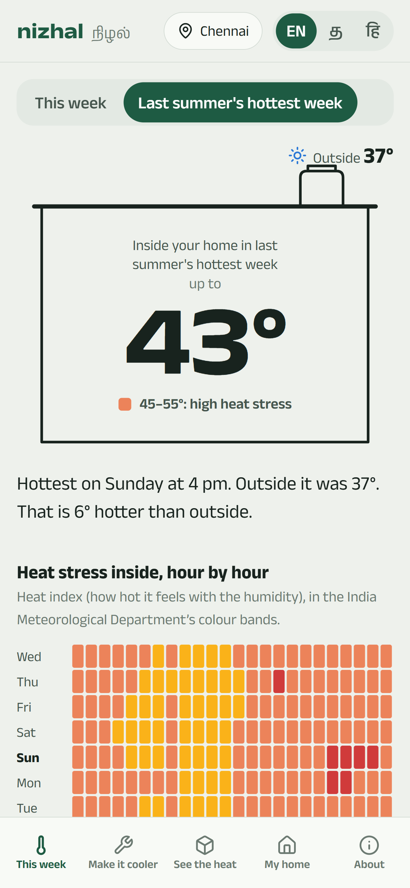
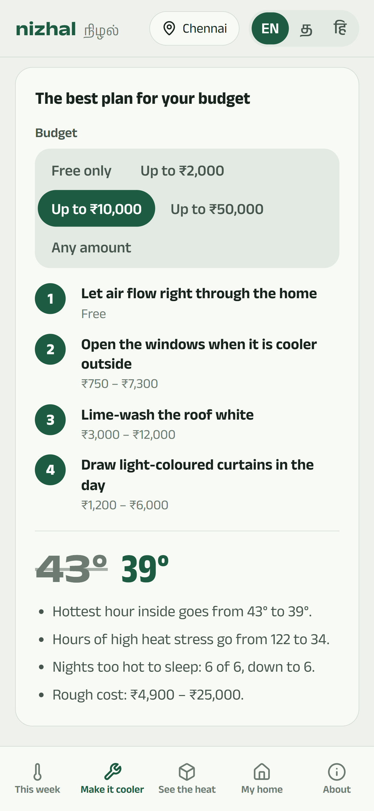
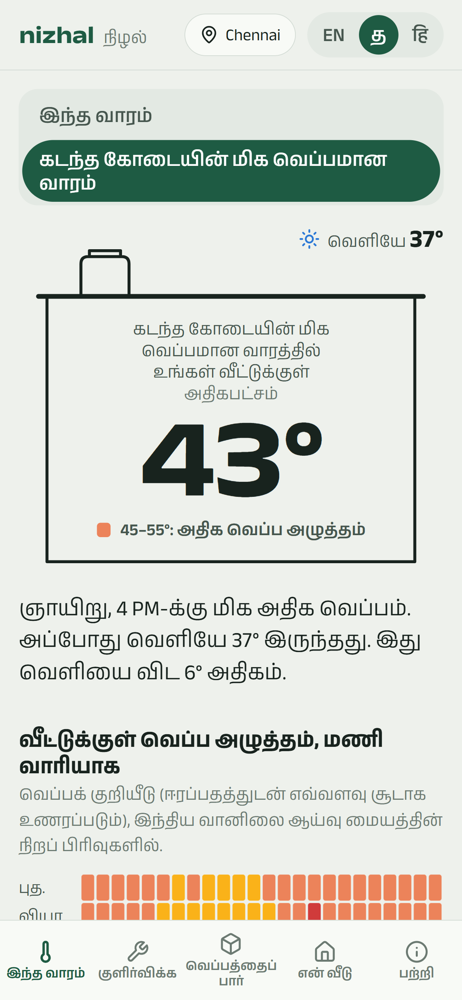
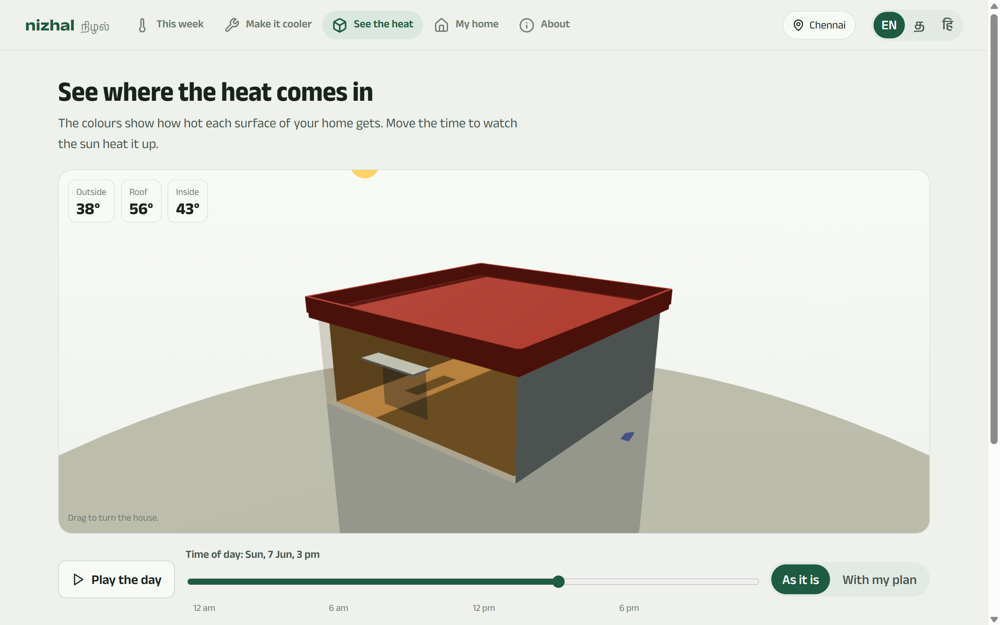

# Nizhal (நிழல்): the indoor heat forecast for Indian homes

**Your weather app tells you it's 37° outside. Nizhal tells you it will be 43° in your
top-floor flat at 4 pm, that opening the windows at the right time keeps the night
about 2° cooler, and which cheap fix is worth your money.**

Nizhal (Tamil for *shade*) builds a physics **digital twin** of a home (its roof,
walls, windows and air) and drives it with real weather for where the home is. It
runs entirely in the browser, works offline, and speaks English, Tamil and Hindi.

**Open it: https://havenleno22.github.io/nizhal/** (works on any phone browser; add it to the
home screen to keep it offline).

<p>
  
  
  
</p>

## Why

India's heatwaves keep getting worse, and most Indian homes have no air
conditioning. Thin concrete roofs and metal or asbestos sheets turn rooms into ovens:
reports describe tin and asbestos homes running 4–6 °C hotter than outdoors, and a
top-floor flat keeps radiating the day's heat long after sunset.

Weather apps only forecast **outdoors**. Nothing tells a family how hot it will get
**inside their own home**, when to open the windows, or which fix is worth their money.

## What it does

* **Indoor forecast.** Hour by hour for the next 7 days: temperature, "feels like"
  (heat index) and a 7 × 24 *heat stress ribbon* in the India Meteorological
  Department's colour bands.
* **Last summer's hottest week**, for any place: works in every season and shows
  what the home is really up against.
* **Tonight's window plan.** When to open and close windows so the night air cools
  the home, and how many degrees that saves.
* **Fix planner.** 13 fixes (lime wash, reflective roof paint, foil under metal
  sheets, shade net, false ceiling, insulation, sunshades, curtains, cross
  ventilation, trees, fans…) are each *simulated on this home*, ranked by relief per
  rupee, and combined into the best plan for a budget. Costs are rough Indian market
  ranges, clearly labelled.
* **See the heat in 3D.** A dollhouse of the home, every surface coloured by its
  simulated temperature, with the real sun for the place and hour. Play a whole day,
  and compare "as it is" with "with my plan".
* **Calibrate with a thermometer.** Enter a few readings (or a logger CSV) and the
  twin fits itself to the real home.
* **Private and offline.** No account, no server. The home never leaves the phone; only
  the location is sent to fetch weather. Built-in weather for 14 cities if offline.
* **English, தமிழ், हिन्दी**, using the Anek type family (Latin, Tamil and Devanagari
  designed together by Ek Type, Mumbai).



## How it works

```
Open-Meteo weather ─► sun on every surface ─► thermal RC network ─► indoor climate ─► heat index, comfort, risk
(forecast / ERA5)      (NOAA, isotropic sky)    (implicit solver)     (hourly)         (NOAA, IMD bands, IMAC)
```

* **Weather:** Open-Meteo forecast and the ERA5 archive (temperature, humidity, wind,
  cloud, direct and diffuse sunlight).
* **Building physics:** every roof, wall and floor is split into its real material
  layers (BIS SP 41 / ASHRAE values). Outer surfaces absorb sun, lose heat to the air
  and radiate to the sky; inner surfaces warm the room by convection and radiation.
  Ventilated false-ceiling voids, foil radiant barriers, gappy clay tiles, shade nets,
  window sunshades, cross ventilation and night flushing are all modelled.
* **Solver:** implicit (backward Euler) time stepping on a ~50-node network, LU
  factorised once an hour and reused every 10 minutes. A week takes about 30 ms, in a
  Web Worker.
* **Comfort and risk:** NOAA heat index on the operative temperature and indoor
  humidity, India Meteorological Department colour bands, IMAC (CEPT University's
  India Model for Adaptive Comfort), and a ceiling-fan effect that fades out above
  37 °C.

The full model, equations and references are in
[docs/how-it-works.md](docs/how-it-works.md).

## What it finds, on real weather

Hottest week of summer 2026 in Chennai (ERA5 outdoor maximum 40.2 °C):

| Home | Hottest hour inside |
|---|---|
| Independent house, grey concrete roof | 40.9 °C |
| Top-floor flat | 42.9 °C |
| Small house with a metal sheet roof | 46.3 °C |

For that top-floor flat, a ₹10,000 plan (cross ventilation, opening windows when it's
cooler outside, lime wash on the roof, curtains) cuts hours of IMD "high heat stress"
in the hottest week from 122 to 34.

These are model estimates, not measurements. See [what to keep in mind](#limits).

## Engineering highlights

* **A tested physics engine** (`src/engine/`, pure TypeScript, no DOM): energy balance
  closes at steady state, results are time-step independent, U-values match textbook
  figures, the heat index matches the NWS chart, and calibration recovers a hidden
  home from noisy readings. `npx vitest run` runs 33 tests in about 5 seconds.
* **The physics never blocks the UI:** a Web Worker runs it; results are cached so
  moving between tabs is instant; superseded requests are dropped.
* **Small first load:** about 92 KB gzipped. three.js (133 KB) loads only with the 3D
  view; built-in weather loads only when needed.
* **Charts built to a data-viz method:** series colours validated for colour-blind
  safety and contrast on Nizhal's own surfaces, legends and direct labels, keyboard
  crosshairs, and a table view for every chart.
* **Type-checked translations:** Tamil and Hindi must provide every English key, or
  the build fails.
* **PWA:** installable, works offline, last weather cached by a service worker.

## Run it

```bash
npm install
npm run dev
```

Then open http://localhost:5173.

```bash
npx vitest run
npm run build
```

`npm run fetch-weather` (via `npx vite-node scripts/fetch-weather.ts`) refreshes the
built-in hottest-week samples; `node scripts/make-icons.mjs` re-renders the PNG icons.

## Project structure

```
src/engine/    physics, weather, comfort, fixes, calibration (no UI code; unit tested)
src/workers/   the engine worker and its message protocol
src/state/     app store (localStorage), weather and engine hooks
src/ui/        screens and charts (React)
src/i18n/      English, Tamil, Hindi
src/data/      built-in weather samples, city list
tests/         Vitest suites; REPORT=1 prints the model's behaviour for review
docs/          design, how it works, interview guide, screenshots
```

## Licence

MIT, see [LICENSE](LICENSE). The Anek typeface is under the SIL Open Font License; built-in
weather is from Open-Meteo (CC BY 4.0).

## Limits

* It is a model, not a measurement. It is usually right about *which* home is hotter
  and *which* fix helps most; a single number can be off by a degree or two.
  Calibrating with a thermometer tightens it.
* The home is treated as one space; upstairs rooms and rooms right under the roof are
  hotter than the average.
* It is not a certified building-energy simulation, and costs are rough ranges.

## Credits and data

* Weather: [Open-Meteo](https://open-meteo.com) (CC BY 4.0): forecast API and ERA5
  reanalysis (Copernicus Climate Change Service).
* Heat index: NOAA / US National Weather Service; risk colours: India Meteorological
  Department's experimental heat index.
* Comfort: IMAC, Manu et al. (2016), CEPT University.
* Typeface: Anek by Ek Type (SIL Open Font License). Icons: Lucide. 3D: three.js.

## Author

Built by **Haven Leno J**, B.Tech CSE student at SRM Institute of Science and
Technology, Ramapuram, with Claude (Anthropic) as an AI pair programmer.

* Portfolio: https://havenleno22.github.io/
* GitHub: https://github.com/HavenLeno22
* LinkedIn: https://www.linkedin.com/in/havenleno
